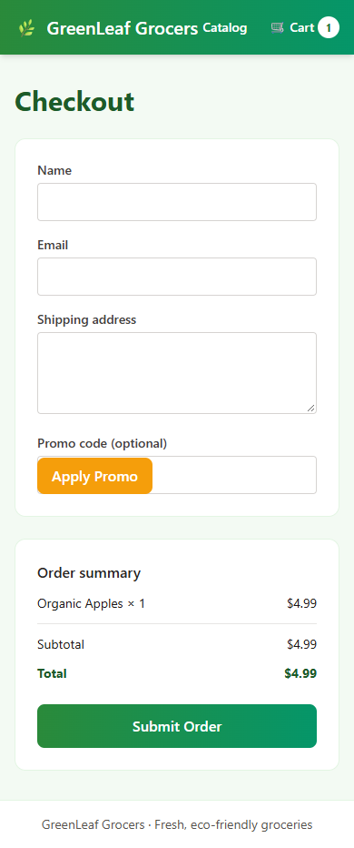

# GreenLeaf QA Capstone | Playwright E2E, API and SQL Testing

Manual QA test design, JavaScript Playwright checkout automation, REST API defect investigation and SQL/SQLite order validation for a simulated e-commerce application.

## Portfolio highlights

- **Test design:** 3 manual cases and 2 historical defect reports.
- **Automation:** 1 verified Playwright checkout test; full runner output included.
- **Backend checks:** order persistence verified in SQLite; expired-promo HTTP500 reproduced.
- **Review first:** [test code](tests/checkout.spec.js), [verified results](evidence/windows-rerun/results.json), [release assessment](reports/reviewed-test-summary.md).

## Project context

Coursework for the Microsoft Junior QA/Software Tester certificate on Coursera. The mock application, lab framework and deliberately seeded defects are course-provided. This portfolio curates completed lab artifacts and separately identified verification performed during portfolio preparation.

## What is included

- 3 manual test cases linked to guest checkout, required-field validation and invalid promo stories.
- 2 original structured bug reports with steps, expected/actual results and severity.
- 1 JavaScript Playwright guest-checkout test and 1 SQL validation query.
- Execution evidence, local workflow records and a reviewed release assessment.

## Verified results — 2026-10-21

| Check | Result |
| --- | --- |
| Guest checkout automation | **1 passed**, exit code 0 |
| SQLite persistence | Guest order stored, total $4.99, status placed |
| Expired promo API | HTTP 500 reproduced for EXPIRED20 |
| Required-field validation | Empty name/email/address block submission |
| Historical mobile overlap | Not reproduced at 390 x 844 in the adapted Windows runtime |

The test code was run unchanged using installed Chrome. The temporary Windows runtime used Node 24.15.0 and better-sqlite3 12.11.1 instead of 11.10.0. This is a new adapted-environment run, not a reconstruction of the historical lab run.

[Runner log](evidence/windows-rerun/playwright-run.txt) · [API and SQL results](evidence/windows-rerun/results.json) · [UI check](evidence/windows-rerun/ui-audit.json) · [Reviewed report](reports/reviewed-test-summary.md)



## Explore the work

| Area | Artifacts |
| --- | --- |
| Manual design | [3 test cases](docs/test-cases.json) |
| Defect reporting | [Original bug reports](docs/bug-reports/) |
| Automation | [Submitted checkout test](tests/checkout.spec.js) |
| Backend validation | [SQL query](sql/order-validation.sql) |
| Traceability | [Local simulated PR and story](docs/local-workflow/) |
| Results | [Reviewed summary](reports/reviewed-test-summary.md) |
| Provenance and limitations | [Review notes](docs/review-notes.md), [runtime notes](docs/runtime-check.md) |

## Tools and workflow

JavaScript, Playwright, SQL/SQLite, Chrome DevTools and a Python HTTP probe. Jira/Zephyr workflows were simulated through local JSON/HTML views. The lab PR is local PR #1, not a live GitHub pull request. Mobile checks used local viewport emulation.

## Running the submitted test

The course application and its dependencies are not included. This repository is an evidence portfolio and requires an available GreenLeaf lab instance with its original selectors and database schema.

From the original lab root, with the application running at localhost:3000 and the submitted test in its tests folder:

```sh
npx playwright test tests/checkout.spec.js --project=chromium
```

The separate [Windows config](evidence/windows-rerun/playwright.windows.config.ts) records the Chrome channel used for verification. It was executed from a temporary lab copy; its relative testDir assumes that layout. The SQL query targets the lab SQLite database.

## Release assessment

**No-Go for the simulated release:** the expired promo request still returns HTTP 500. The historical mobile issue requires investigation in the original lab environment before closure. The complete evidence limits are documented in the reviewed report.

## Historical records

Original reports and runner output are preserved for traceability and can contain superseded or contradictory claims. Use the reviewed summary for current conclusions. Phase 1 ticket views originally supplied with PNG names were HTML; their extensions are corrected. They are not direct screenshots of the application defect.

## Related QA portfolio work

[MindBridge automation and reporting](https://github.com/Gultekinn/mindbridge-qa-automation) | [Manual QA practice labs](https://github.com/Gultekinn/qa-practice-labs)
